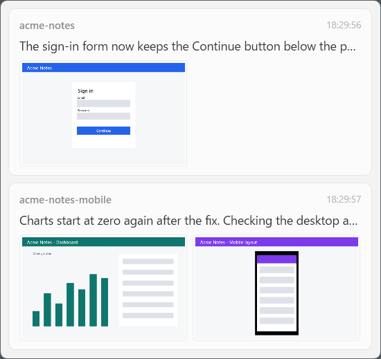

# Agent Image Viewer

A small Windows tray app that shows the images a coding agent looks at, such as Claude Code
or the Antigravity CLI, so you can follow its work (for example, the screenshots it takes
while developing) in near real time.



Each image arrives as a card together with the message the agent wrote alongside it.
The window stays out of the way: it lives in the tray, never takes focus, and hides
itself when there is nothing to show.

> **Unofficial.** This project is not affiliated with, endorsed by, or sponsored by
> Anthropic or Google. Claude and Claude Code are trademarks of Anthropic; Antigravity is a
> trademark of Google. They are named here only to say which agents the hook works with.

The user interface (menus and settings) is in Japanese.

## Features

- Tray-resident; no window until the first card arrives, hidden again when empty
- Cards of "session name + message + thumbnails", newest at the bottom, up to N cards
- Images belonging to the same agent message are merged into one card
- Click a thumbnail for a full-screen preview at actual pixel size
  - Mouse wheel to zoom, drag to pan, click or Esc to close
- Frameless Fluent (Mica) window: drag anywhere to move, snaps to screen edges,
  width is resizable
- Remembers the monitor and position; when docked to the bottom edge, it grows upward
- Settings from the tray menu: max cards, theme, opacity, notification sound,
  always on top, start with Windows

## Requirements

- Windows 10/11 with the [.NET 10 Desktop Runtime](https://dotnet.microsoft.com/download/dotnet/10.0)
- A coding agent running in **WSL** on the same machine: Claude Code or the Antigravity CLI
  (the hook relies on WSL interop to call the Windows executable), with Python 3
- To build: WSL with Docker (the build runs in the `mcr.microsoft.com/dotnet/sdk:10.0` container)

Agents running natively on Windows or on a remote machine over SSH are not supported by the hook.

## Build and install

From WSL, in the repository root:

```sh
make deploy
```

This builds a framework-dependent single-file `AgentImageViewer.exe` in a container,
stops the running viewer, copies the exe to
`%LOCALAPPDATA%\Programs\AgentImageViewer\` and starts it.

| Target | Description |
|---|---|
| `make publish` | Build `dist/AgentImageViewer.exe` |
| `make install` | Copy the exe to the install directory |
| `make stop` / `make start` | Stop / start the installed viewer |
| `make deploy` | `publish`, `stop`, `install`, `start` |

Set `INSTALL_DIR` to install somewhere else.

## Connecting a coding agent

The agent does not talk to the viewer itself: a `PostToolUse` hook passes the images on.
[`hooks/image_viewer_hook.py`](hooks/image_viewer_hook.py) is that hook, for Claude Code and the
Antigravity CLI running in WSL. It needs only Python 3 (standard library) and the viewer installed
with `make install`. For each image the agent looks at, it

1. copies the image, so the agent may change or delete it right away,
2. returns at once and, in a detached process, waits until the agent has written the tool call to
   its transcript and takes the text the agent wrote just before it,
3. posts images and text with `AgentImageViewer.exe post`; images read under one message share a card.

Add the hook to the agent's settings, with the real path of the script:

| Agent | Where | Example |
|---|---|---|
| Claude Code | `~/.claude/settings.json` (all projects) or `.claude/settings.json` | [`hooks/claude-code.json`](hooks/claude-code.json) |
| Antigravity CLI | `~/.gemini/config/hooks.json` (all workspaces) or `<workspace>/.agents/hooks.json` | [`hooks/antigravity.json`](hooks/antigravity.json) |

Claude Code sends images read with `Read` and images that MCP tools (such as browser screenshots)
return or save; Antigravity sends images read with `read_file`. Set `AGENT_IMAGE_VIEWER_EXE` if
the exe is not in the default install directory. Any other agent can call the command line below
from a hook of its own.

The viewer's command line:

```text
AgentImageViewer.exe post --session <id> [--group <id>] [--session-name <name>]
                           [--cwd <dir>] [--text-file <path>] <image path>...
AgentImageViewer.exe show
AgentImageViewer.exe quit
```

| Option | Meaning |
|---|---|
| `--session` | Claude Code session id (required) |
| `--group` | Id of the agent message; posts with the same session and group are merged into one card |
| `--session-name` | Card title (defaults to the folder name of `--cwd`) |
| `--cwd` | Working directory of the session |
| `--text-file` | File containing the message text shown on the card (a Windows path; read before the command returns, so the caller may delete it then) |

Image paths must be Windows paths (use `wslpath -w` from WSL): local paths or paths under
`\\wsl.localhost\` or `\\wsl$\`. Other UNC paths are ignored, and so are files over 100 MB and
files that are not PNG, JPEG, GIF, BMP, WebP or TIFF (WebP needs the WebP codec on Windows 10).
The viewer copies the images into its own cache, so the caller may delete them as soon as
the command returns.

`post` starts the viewer if it is not running. It gives up if the viewer does not answer
within about 20 seconds, so call it from a detached process in your hook to avoid delaying
Claude Code. The command line talks to the resident viewer over a named pipe that only the
current user can open.

| Exit code | Meaning |
|---|---|
| 0 | The viewer received the command (images it cannot use are skipped silently) |
| 1 | The viewer could not be reached or did not answer |
| 2 | Invalid command line; the usage is printed |

The exe is a Windows GUI program, so messages it prints show up when it is run from WSL but
not in a Command Prompt or PowerShell window.

## Data

| Path | Content |
|---|---|
| `%APPDATA%\AgentImageViewer\settings.json` | Settings |
| `%LOCALAPPDATA%\AgentImageViewer\cache\` | Copies of received images; cleared on start, on exit and when Windows signs out |
| `%LOCALAPPDATA%\AgentImageViewer\error.log` | Details of an unexpected error that ended the viewer, if any |

"Start with Windows" adds a `AgentImageViewer` value under
`HKCU\Software\Microsoft\Windows\CurrentVersion\Run`. Saving the settings again updates it
if the exe has moved.

## Uninstall

1. Turn off "Start with Windows" in the settings (or delete the `Run` value above).
2. Choose 終了 (Exit) from the tray menu.
3. Delete `%LOCALAPPDATA%\Programs\AgentImageViewer\`, `%LOCALAPPDATA%\AgentImageViewer\`
   and `%APPDATA%\AgentImageViewer\`.

## Development

| Path | Content |
|---|---|
| `src/AgentImageViewer.Core/` | Everything that does not need a window: command line, pipe protocol, settings, image cache, card rules (`net10.0`) |
| `src/AgentImageViewer/` | The WPF app: windows, tray icon, thumbnails, Win32 interop (`net10.0-windows`) |
| `tests/AgentImageViewer.Core.Tests/` | Tests for Core; run on any OS |
| `tests/AgentImageViewer.Tests/` | Tests for the WPF side; run on Windows only |
| `hooks/` | The agent hook, its settings examples and its tests (`hooks/tests/`) |

Everything runs in the SDK container, so nothing has to be installed besides Docker:

| Target | Description |
|---|---|
| `make build` | Build the whole solution (the Windows projects compile on Linux too) |
| `make test` | Build and run the Core tests and the hook tests |
| `make test-hooks` | Run only the hook tests (in a `python:3.12-slim` container) |
| `make format` / `make format-check` | Apply / verify the code style in `.editorconfig` |
| `make clean` | Remove build output |

On Windows with the .NET 10 SDK, `dotnet test --solution AgentImageViewer.slnx` also runs the WPF tests.
GitHub Actions does both for pull requests and pushes to `main`: the Linux job checks formatting and runs the
Core tests, the Windows job runs all tests and publishes the exe.

The command line, exit codes, pipe message format and settings file are a contract with hooks
and with existing installations; the Core tests pin them.

## License

[MIT](LICENSE)

Built with [WPF UI](https://github.com/lepoco/wpfui) (MIT), which is included in the exe; see
[THIRD-PARTY-NOTICES.txt](THIRD-PARTY-NOTICES.txt). Distribute that file with the exe.
